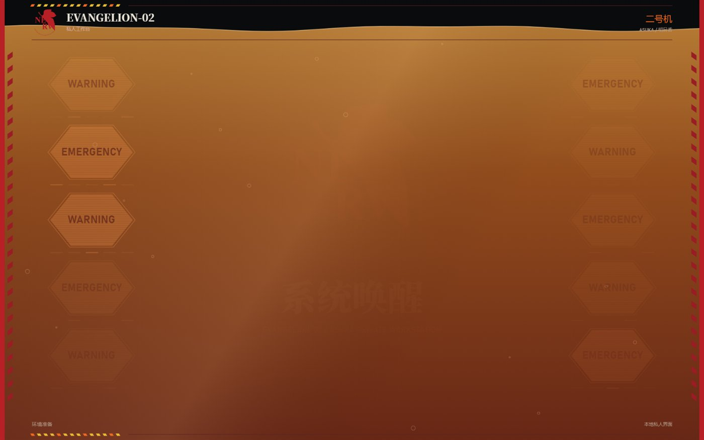
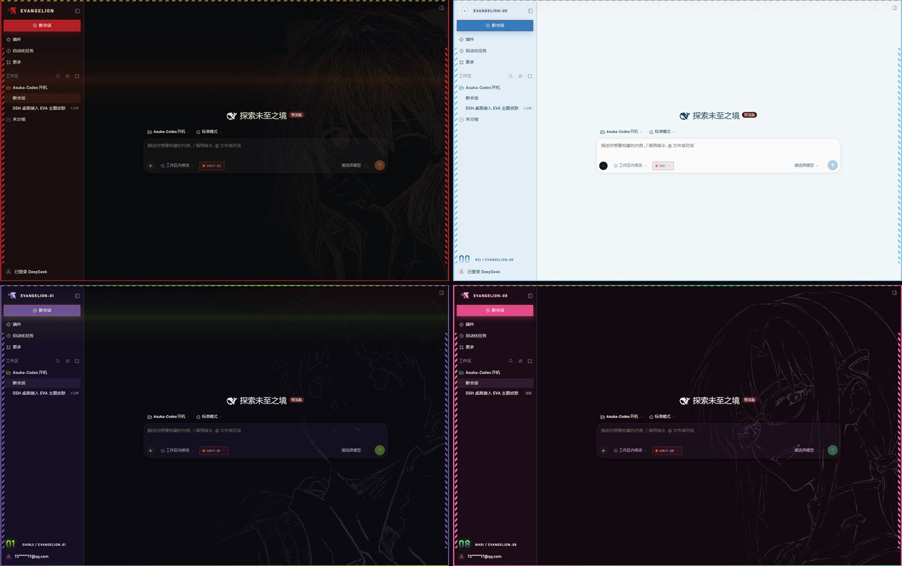
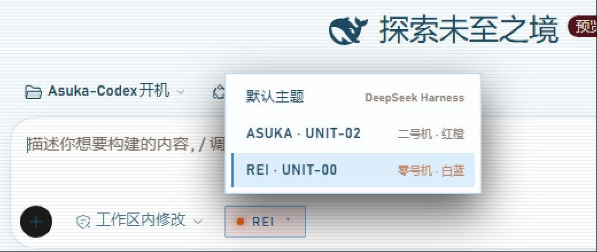

# DSH EVA 皮肤合集（二号机 / 零号机 / 初号机 / 八号机）

DeepSeek Harness 桌面客户端的原生皮肤插件：**一个插件，四套皮肤**，可在应用内随时切换，随时切回默认主题。

不修改 DSH 安装目录、不替换 `app.asar`、不需要独立启动器——皮肤就是 DSH 里的一个插件，从 DSH 桌面图标启动即生效。

---

## 预览

**开机动画**（约 20 秒，可 Esc 跳过，可 Ctrl+Alt+B 重播）



**四套皮肤的工作台**



**切换皮肤**：点输入框左侧的胶囊



---

## 版权声明（请先读这一段）

**代码**（`lib/`、`client/client.js`、安装脚本）以 MIT 许可发布。

**图像与音频素材不在此许可范围内**：`EVANGELION`、`NERV`、`EVA` 机体与角色形象（明日香 / 绫波丽 / 碇真嗣 / 真希波）版权归 **khara** 所有。本仓库把它们**作为粉丝创作一并分发**，未取得授权，作者不对这些素材主张任何权利，也**不用于任何商业用途**。若版权方提出异议，相关素材会立即下架。介意版权的话，可按文末「替换素材」换成中性占位图，代码与全部交互逻辑不受影响。

---

## 一、安装

### 方式 A：zip（推荐，最简单）

到 [Releases](../../releases) 下载对应平台的包：

| 平台 | 文件 | 装法 |
| --- | --- | --- |
| Windows | `dsh-eva-skins-<版本>.zip` | 解压后**双击 `一键安装.cmd`** |
| macOS | `dsh-eva-skins-<版本>-mac.zip` | 解压后 `bash install-mac.command` |

**装完必须彻底退出 DSH**（任务栏图标右键退出，或任务管理器结束 `DeepSeek Harness.exe`），再重新打开。只关窗口不算。

### 方式 B：从仓库直接装（免下载 zip）

```bash
git clone https://github.com/Iris-change/dsh-eva-skins.git
dsh plugin --profile desktop add ./dsh-eva-skins
```

或者不放命令，把仓库地址丢给 DSH 里的 agent：「帮我把这个皮肤装上」。

> 本地路径方式在 profile 里记的是 `link:` 软链 —— 这个文件夹删了，皮肤就失效。想长期用建议留着它，或者走方式 A。

### 方式 C：npm

**暂未发布到 npm**。仓库本身已经是标准 npm 包结构（`package.json` 里有 `dsh.bundle` / `dsh.client` 字段），以后发布的话一行就能装：

```bash
dsh plugin --profile desktop add dsh-eva-skins
```

### 让 agent 帮你装

也可以直接把仓库地址丢给 DSH 里的 agent：「帮我把这个皮肤装上」。它会执行 `dsh plugin add`。前提是给会话**完全访问**权限（安装要写 `~/.dsh/profiles/desktop/`，工作区之外的写入在 `workspace-write` 模式下会被拒绝）。

---

## 二、切换皮肤

装好后，**输入框左侧**会出现一个胶囊按钮：

```
● UNIT-02 ▾
```

点开是一个列表，四选一（外加「默认主题」）：

| 皮肤 | 机体 | 配色 |
| --- | --- | --- |
| `ASUKA · UNIT-02` | 二号机 | 红橙 |
| `REI · UNIT-00` | 零号机 | 白蓝 |
| `SHINJI · UNIT-01` | 初号机 | 紫绿 |
| `MARI · UNIT-08` | 八号机 | 粉绿 |
| `默认主题` | — | 回到 DSH 原生外观 |

**快捷键**

| 组合 | 作用 |
| --- | --- |
| `Ctrl + Alt + U` | 开 / 关皮肤 |
| `Ctrl + Alt + B` | 重播开机动画 |
| `Esc` | 跳过开机动画 |

**控制台 API**

```js
window.unit02Skin.setSkin("rei")   // "off" | "asuka" | "rei" | "shinji" | "mari"
window.unit02Skin.replayBoot()
window.unit02Skin.openPicker()
```

选择会存进 `localStorage`，下次启动保持一致。

---

## 三、开机动画

每套皮肤都有自己的开机序列（`EVANGELION-02 / 00 / 01 / 08`）：系统唤醒 → LCL 注入 → 同步率 → 驾驶员确认卡 → 转场到工作台。

- 时长约 20 秒，中间在 13.3 秒处**定格等确认**，点「驾驶员确认，开始同步」继续
- 右下角「进入工作台」或 `Esc` 可直接跳过
- 每次重新打开应用播一次；20 分钟内刷新页面不重复播放
- 动画里的日文播报来自 `media/**/voice.wav`，默认开启；无声卡环境会自动回退到挂钟计时

---

## 四、已知限制

1. **窗口标题栏改不了**。右上角 `— □ ✕` 那条是 Electron 主进程绘制的 `titleBarOverlay`，颜色写在 exe 里，插件的 CSS 触碰不到。缓解方式：页面顶部有一条 2px 的皮肤色细线做衔接。
2. **`Ctrl+R` 不一定能重载**。本版本应用菜单未绑定重载快捷键；改完皮肤请彻底退出再启动。
3. **macOS 安装脚本未在真机验证**。`install-mac.command` 里的 DSH 路径按 Windows 版结构推断，并带 `command -v dsh` 兜底；报 `not found` 请在 Issue 里附上 `ls /Applications` 的结果。

---

## 五、目录结构

```
dsh-eva-skins/
├── package.json          插件身份（name / dsh.bundle / dsh.client / files）
├── cordis.patch.yml      装进 DSH 的入口，只有一条 insert
├── lib/index.js          host 侧：为四套动画各注册一条静态路由
├── client/
│   ├── client.js         主题 token、侧栏、边框、胶囊、菜单、iframe 壳
│   ├── intro/            二号机素材（25 个文件）
│   ├── intro-rei/        零号机素材（31）
│   ├── intro-shinji/     初号机素材（26）
│   └── intro-mari/       八号机素材（27）
├── 一键安装.cmd / 卸载.cmd / 使用说明.txt
├── install-mac.command / uninstall-mac.command
└── README.md / LICENSE / .gitignore
```

四套皮肤共用一个 `client.js`：它读当前皮肤 id，加载对应的动画 iframe（`/unit02-intro/` `/rei-intro/` `/shinji-intro/` `/mari-intro/`），再把 CSS 变量与装饰层切过去。**不是四个插件**，所以不会出现四份样式互相覆盖。

新增一套皮肤的改动点在 `client.js`：`SKIN_IDS`、`SKINS`、`INTRO_SRC`、CSS 块、`lib/index.js` 的 `MOUNTS` —— 五处。

---

## 六、卸载

```bash
dsh plugin --profile desktop remove dsh-eva-skins
```

或运行 `卸载.cmd` / `bash uninstall-mac.command`，然后彻底退出重开。

---

## 七、替换素材（想开源/商用时的做法）

动画按目录读图，替换同名文件即可，不需要改代码：

| 文件 | 用途 |
| --- | --- |
| `client/intro*/media/pilot/*.png` | 确认卡上的驾驶员头像 |
| `client/intro*/media/pilot/*lineart*.png` | 工作台右侧的人像线稿 |
| `client/intro*/media/eva/nerv-mark.svg` | 侧栏与动画里的 NERV 叶标 |
| `client/intro*/media/audio-*/voice.wav` | 开机播报音轨 |

换成中性占位图后，这套皮肤的代码与交互逻辑可以完整保留并公开分发。

---

## 八、开发与发布

```bash
# 本地验证（不上桌面端，跑一个 web profile 观察界面）
dsh --profile web --no-open --host 127.0.0.1 --port 43137
# 输出里带 token 的 URL 直接打开

# 发布
npm version patch
npm publish
git push --follow-tags
```

`package.json` 的 `files` 只包含 `lib`、`client`、`cordis.patch.yml`、`README.md`、`LICENSE`，所以 npm 包里不会混进安装脚本以外的杂项。

版本历史见 [CHANGELOG.md](CHANGELOG.md)。
